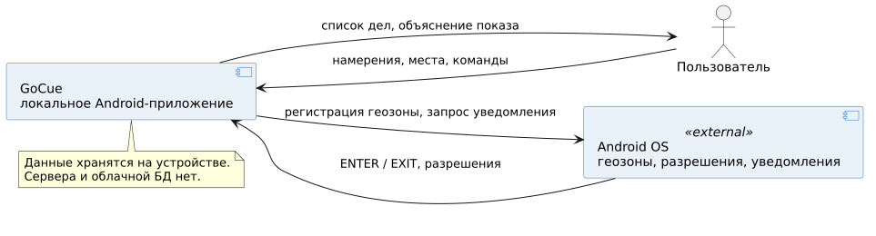
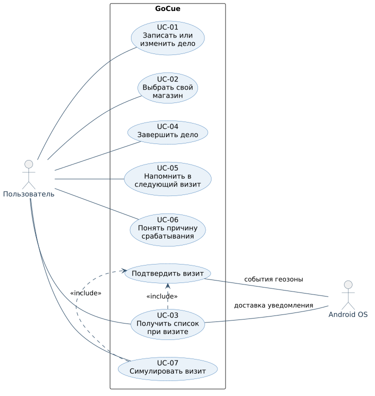
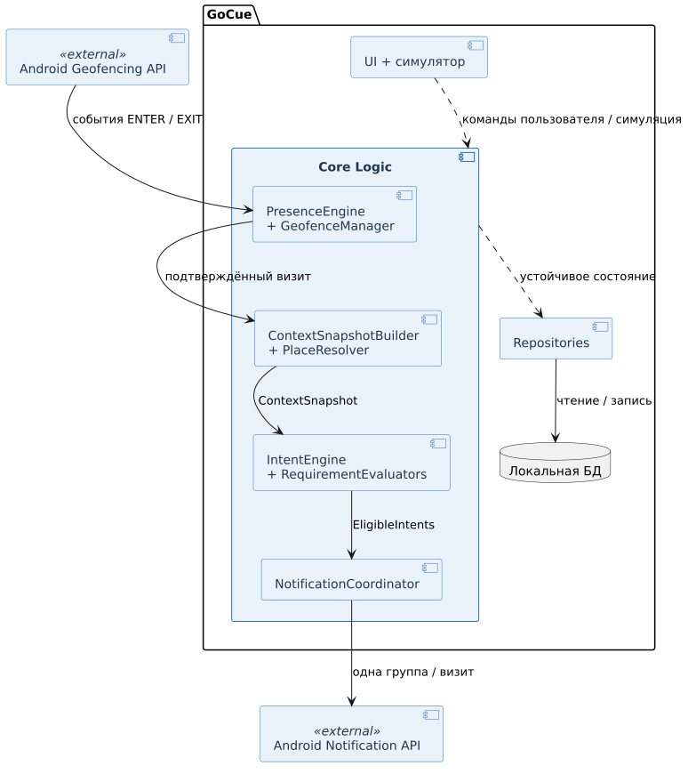
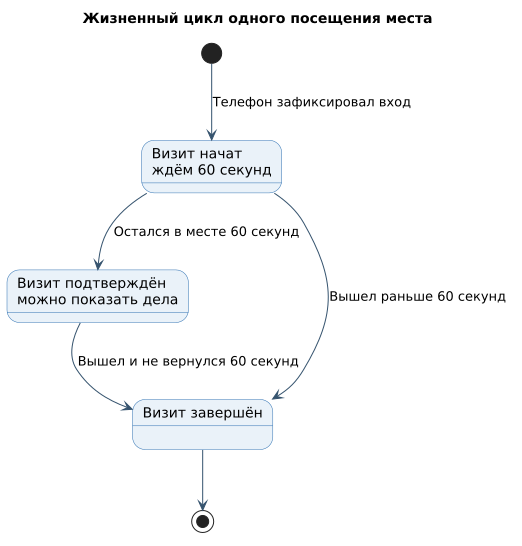
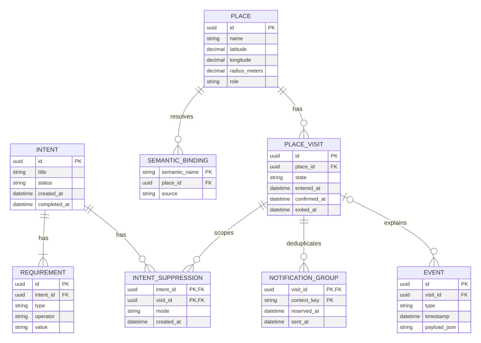

# GoCue — технический проект

**Лабораторная работа № 2 · версия 1.0 · 28.10.2026**  
Команда «Диалог», группа ПИб-23Э1.  
Проектная документация; схемы описывают планируемую систему, а не готовый прототип.

## 1. Исходные решения

Основной сценарий — намерение «Купить батарейки» с требованием `MY_SUPERMARKET`. Псевдоним разрешается в сохранённое физическое место. Android сообщает вход/выход из геозоны; модуль присутствия подтверждает визит после выдержки; движок намерений получает только `ContextSnapshot`. Все подходящие дела группируются и показываются один раз за визит. Данные и журнал событий находятся на устройстве.

Проект не требует сервера. Для будущего Android-прототипа предложены Kotlin, нативный интерфейс, системные геозоны и уведомления, локальная реляционная БД; конкретные библиотеки и версии будут зафиксированы при начале реализации. Структура ниже — логическое разбиение, а не утверждение о существующем коде.

**Ключевой инвариант:** `IntentEngine` не получает координаты, сырые GPS-точки или системные callback'и. Он работает с нормализованным контекстом, поэтому одинаковые входные данные дают одинаковый результат.

## 2. Контекстная диаграмма

Показывает границу GoCue, пользовательский ввод, системные события Android и локальное хранилище. Внешнего сервера нет.

Редактируемый исходник PlantUML: [`01-context.puml`](diagrams/01-context.puml).

## 3. UML Use Case — варианты использования

Пользователь создаёт намерения и места, получает список, завершает или переносит дело, просматривает причину срабатывания и запускает симуляцию. Android участвует в доставке события и уведомления. Диаграмма использует канонические элементы UML: акторов, овалы вариантов использования, границу системы, ассоциации и связи `«include»`. Подтверждение визита — включаемый внутренний шаг для реального и симулированного сценария.

Редактируемый исходник PlantUML: [`02-use-case.puml`](diagrams/02-use-case.puml). Соответствие `UC` и критериев приёмки дано в [ТЗ](Техническое_задание.md#5-основные-сценарии-использования).

## 4. UML-диаграмма классов

`Intent` владеет одним или несколькими `Requirement`. `SemanticPlaceBinding` разрешает псевдоним в физическое `Place`, не меняя намерение. `Visit` хранит факт посещения, `Suppression` связывает намерение с конкретным визитом. `ContextSnapshot` — временный объект оценки, не таблица БД. `RequirementEvaluator` — интерфейс для проверок роли и семантического места.

Редактируемый исходник PlantUML: [`03-class.puml`](diagrams/03-class.puml).

## 5. UML-диаграмма развёртывания

Все артефакты приложения и БД размещены на узле-устройстве. Внутри показаны среды выполнения Android и GoCue, а также системные службы геолокации и уведомлений. Внешняя сеть не нужна для базовых операций. Samsung Galaxy S25 обозначен как устройство испытания, а не единственная поддерживаемая модель.

Редактируемый исходник PlantUML: [`04-deployment.puml`](diagrams/04-deployment.puml).

## 6. UML-диаграмма компонентов

Поток данных: `GeofenceManager` → `PresenceEngine` → `ContextSnapshotBuilder` → `IntentEngine` → `NotificationCoordinator`. На UML-диаграмме показаны символы компонентов UML2, составной компонент `Core Logic`, зависимости и подписанные контракты `ContextSnapshot` и `EligibleIntents`. `PlaceResolver` добавляет к физическому месту роли и семантические имена. Репозитории скрывают хранение. Интерфейс и симулятор используют те же правила, что и реальные системные события.

Редактируемый исходник PlantUML: [`05-components.puml`](diagrams/05-components.puml).

## 7. UML-диаграмма деятельности

На сыром `ENTER` создаётся только кандидат. После выдержки 60 секунд при сохранении нахождения внутри геозоны визит подтверждается. Движок фильтрует активные, подходящие и не подавленные дела. `NotificationCoordinator` проверяет устойчивый ключ `(visitId, contextKey)`; запись ключа должна предшествовать запросу уведомления, чтобы повторная оценка и перезапуск не дали дубль.

Редактируемый исходник PlantUML: [`06-activity.puml`](diagrams/06-activity.puml). Предварительное резервирование ключа защищает от дублей, но при сбое между резервированием и отправкой возможно пропущенное уведомление. Для прототипа это сознательный выбор в пользу тишины; испытания должны оценить компромисс и при необходимости добавить состояние доставки/повтор с тем же ключом.

## 8. UML-диаграмма состояний визита

Выбран вариант **диаграммы состояний** из предложенных заданием. На диаграмме есть техническое состояние `EXIT_PENDING`: после `EXIT` запускается 60-секундная антидребезговая пауза. Возврат за это время сохраняет `visitId`; иначе визит становится `ENDED`. Состояния `OUTSIDE` и `EXIT_PENDING` относятся к Presence Engine; в БД `PlaceVisit.state` хранит `CANDIDATE`, `CONFIRMED`, `ENDED`, а ожидающий выход может быть представлен отдельным полем/событием таймера.

Редактируемый исходник PlantUML: [`07-state.puml`](diagrams/07-state.puml). Правило антидребезга — проектное дополнение к исходной продуктовой спецификации и проверяется по `AC-14`.

## 9. ER-диаграмма данных

Схема разделяет семантическое требование и физическое место. В `NOTIFICATION_GROUP` хранится устойчивый ключ дедупликации. Журнал `EVENT` служит объяснению и отладке, но не заменяет основные таблицы: полное event sourcing не требуется.

Редактируемый исходник PlantUML: [`08-er.puml`](diagrams/08-er.puml). Поля `source`, `updated_at`, дополнительная диагностика разрешений и индексы могут быть добавлены при физическом проектировании БД; обязательные связи и ключи показаны здесь.

## 10. Правила согласованности и хранения

1. `Requirement.value` хранит роль или семантический псевдоним, но не координаты. `SEMANTIC_PLACE = MY_SUPERMARKET` разрешается только через `SemanticPlaceBinding`.
2. Для `(semantic_name)` допускается не более одной активной привязки. Переустановка привязки меняет единственную запись; намерения не редактируются.
3. `IntentSuppression` уникален по `(intent_id, visit_id)`. Он не переводит намерение в другое состояние. При новом визите старое подавление не влияет на результат; историческую запись можно оставить для аудита.
4. `NotificationGroup` уникален по `(visit_id, context_key)`. `context_key` строится из идентификатора физического места и семантического/ролевого контекста; он не зависит от порядка дел в списке.
5. При завершении намерения его статус становится `COMPLETED`; дальнейшие оценки его игнорируют. Исторические события сохраняются до явного удаления пользователем.
6. Удаление физического места удаляет активную семантическую привязку после предупреждения; намерения остаются, но не срабатывают, пока место не выбрано снова.
7. Обработчики Android и симулятор передают события одному Presence Engine. Повторный callback с тем же смыслом должен быть идемпотентным.
8. Очистка истории удаляет завершённые визиты и события, но не активные намерения и места. Текущий визит и его ключ дедупликации сохраняются до выхода или завершаются без немедленного повторного показа, чтобы очистка не создала дубль.

## 11. Трассировка требований и диаграмм

| Диаграмма | Главные требования ТЗ |
| --- | --- |
| Контекстная | FR-01, FR-03, FR-06, FR-08, NFR-01, NFR-07 |
| Use Case | UC-01…UC-07; FR-01…FR-13 |
| Классов | FR-01…FR-10, NFR-02 |
| Развёртывания | FR-06, FR-08, FR-10, NFR-01, NFR-07 |
| Компонентов | FR-04…FR-12, NFR-02 |
| Деятельности | FR-06…FR-10, AC-06…AC-10 |
| Состояний | FR-06, FR-14, AC-06, AC-07, AC-14 |
| ER | FR-01…FR-11, FR-17, NFR-04, NFR-08 |

## 12. Открытые вопросы и проверка

- Реальные задержки системной геозоны, необходимая точность и энергопотребление — измерить на Galaxy S25; гарантий своевременного срабатывания до испытаний нет.
- Порог выдержки 60 секунд и антидребезг 60 секунд — стартовые параметры, менять по протоколу испытаний.
- Конкретные библиотека БД и UI-стек — выбрать при реализации, не выдавая проектную схему за готовый код.
- Уточнить, что делает приложение, если системное уведомление не доставлено после резервирования ключа; базовое поведение предпочитает отсутствие дубля, возможный пропуск фиксируется в журнале.

Основание: [исходная спецификация](../product-spec.md) и [ТЗ ЛР2](Техническое_задание.md). Все восемь диаграмм доступны как редактируемые `.puml` файлы в репозитории, их визуализации встроены в этот документ. Ссылка на ресурс: <https://github.com/techmo0/GoCue/tree/main/docs/lab-02>.
